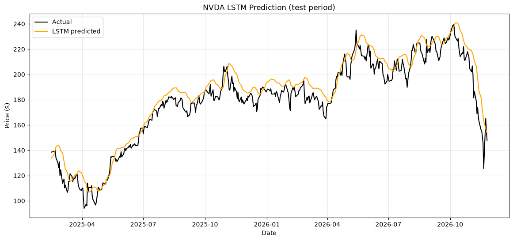
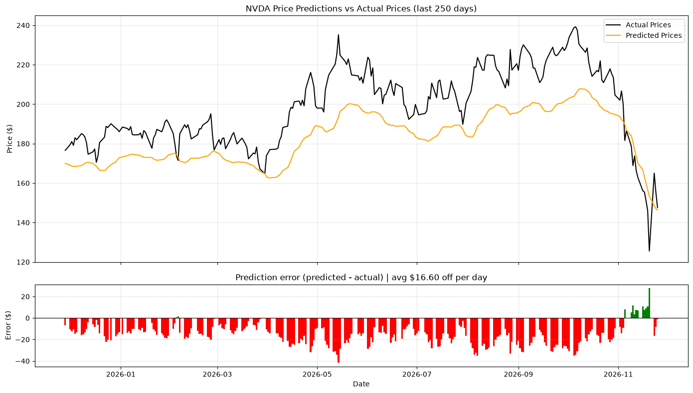
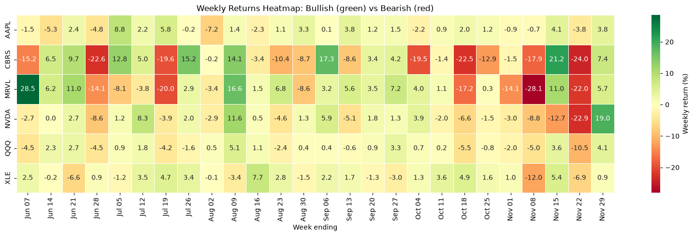
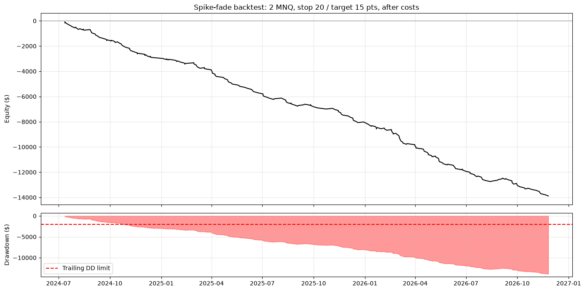
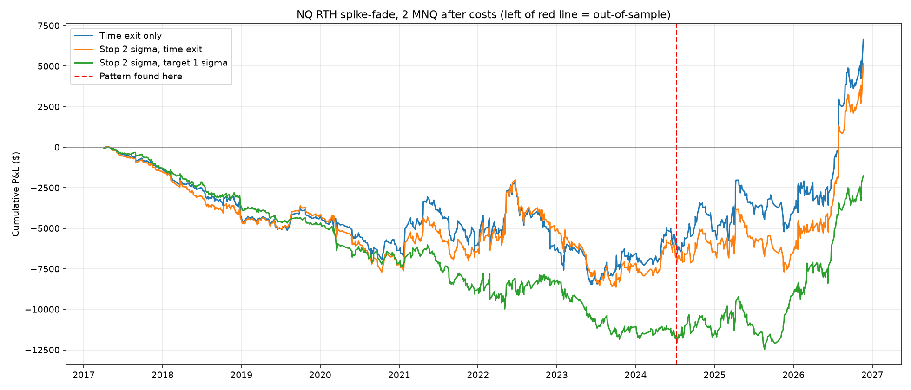

# Testing Intraday Mean Reversion in NQ Futures: A Research Log

This is a research write-up of a one-day study. It is not a strategy pitch. The short version: price-forecasting models did not beat a naive baseline, a mean-reversion pattern showed up in one recent window of NQ, and that pattern did not survive an out-of-sample test on minute data back to 2017.

## Summary

I started by trying to predict prices with linear regression and an LSTM. Both failed in the same way: they lagged the last price. The LSTM's mistakes looked a bit like short-term mean reversion, so I tested reversion directly. On NQ hourly bars from July 2024 to November 2026, a large regular-hours up-move was followed by a pullback often enough to look like an edge. On 9.5 years of NQ minute bars the same rule lost money out of sample. The profits are concentrated in 2026.

## Part 1: Why ML price prediction failed

**Linear regression.** Five lagged daily closes, NVDA, train on the first 80% of the sample and test on the last 20%. Test error was $3.75 per day. The naive forecast "tomorrow's close equals today's close" was also $3.75 per day. The model learned persistence, not a prediction.

**LSTM on prices.** Same idea, 60 days of history, scaler fit on the training window only. Test error was $8.18 per day against $3.57 for the naive forecast. Training loss and validation loss in that run were far apart, on the order of 10–20x in the worse epochs. Fitting the scaler on training prices only also puts a ceiling on the forecast: the network cannot represent prices above the training range. A lot of tutorials hide that by fitting the scaler on the whole series, which leaks the future into the scaling.



The error chart below is a second price-LSTM fit, from notebook 05, and it is not the $8.18 number. The title on the figure is the average absolute error over the last 250 days of that run, $16.60. Notebook 04's full test-set error is the $8.18 figure. I am not treating those as the same statistic.



**LSTM on returns.** Switching the target to daily returns, and charging 0.1% when the position changes, beat buy and hold on NVDA in 5 of 5 seeds. It did not beat buy and hold on AAPL, MSFT, SPY, or QQQ. The NVDA result came from sitting out one crash. Directional accuracy on that returns run was 51.8%, against 50.9% for always guessing up. The 55% figure is a different test, on the price model's predicted move. It is described in the note at the end.



Lesson from this part: compare to a naive baseline, and repeat the test across seeds and tickers.

## Part 2: From model artifact to hypothesis

The price models were mostly copying yesterday. What small directional tilt they had looked like short-term mean reversion, so I tested reversion by itself and dropped the network.

**Daily.** After a fixed up move of more than 3%, QQQ closed lower the next day 63% of the time. A volatility-adjusted threshold (up more than 2 standard deviations of the last 20 daily returns) and a by-year split showed that this was carried by a few years, including 2020. I rejected the daily rule.

**Intraday NQ, Yahoo hourly bars, July 2024 to November 2026.** After a regular-hours hour up more than 2 standard deviations, the next hour pulled back 57% of the time, by 15.8 points on average, on 260 bars. The sign agreed in both halves of that window. Overnight bars were noise.

## Part 3: Backtesting it properly

The first backtest used those Yahoo hourly bars, a 20-point stop, a 15-point target, and the assumption that if the next hour touched both, the stop filled first. Two MNQ, with commission and one point of slippage. It lost $13,884. That loss is not informative: 63% of the trades touched both the stop and the target inside the same hourly bar, so the fill order was an assumption, not a measurement. A time exit at the next hourly close, on the same signals, made +13.2 points per trade. That result is still inside the sample where the pattern was found.



I rebuilt the test on Massive Flat Files. The archive used here is 3.38 million NQ minute bars, 2017 through 2026, 39 outright contracts rolled by volume. Returns are not taken across a roll. Stops and targets are filled on the minute bars. Stops are scaled to recent hourly volatility. Costs are MNQ costs, and there is a daily loss limit. The in-sample window starts 2024-07-07, the date the Yahoo pattern was measured. Everything before that is out of sample.

Results for 2 MNQ, after costs:

| Setup | Out-of-sample 2017-24 | In-sample 2024-26 |
| --- | --- | --- |
| Time exit | 801 trades, 43% win, -1.1 pts, -$5,995, PF 0.90 | 247 trades, 55%, +13.6 pts, +$12,656, PF 1.46 |
| Stop 2σ | -1.4 pts, -$6,790, PF 0.88 | +12.8 pts, +$11,939, PF 1.44 |
| Stop 2σ / target 1σ | -2.9 pts, -$11,699, PF 0.77 | +10.8 pts, +$9,934, PF 1.44 |

Out of sample, the next hour closed down after a spike 45.8% of the time. The spikes continued. That is momentum, not reversion. In sample the same rate was 55.6%.

By year, on the time exit: 2017–2020 negative, 2021–2023 flat, 2024–2025 about +4 pts, 2026 +28.4 pts. Most of the in-sample profit is 2026.



A walk-forward filter trades a month only when the trailing 100 signals averaged more than 0 points at the start of that month. It took no trades in 2017–2019, lost $2,582 on false starts in 2021–2022, and finished at +$9,286 against +$6,661 for the always-on time exit. From 2020 through 2025, excluding 2026, it was about -$470.

## Conclusion

Not a stable edge historically. A walk-forward filter (trade only when the trailing 100 signals averaged > 0 pts) avoided 2017–2019, lost $2,582 on false starts in 2021–2022, and totaled +$9,286 vs +$6,661 always-on, but netted about -$470 over 2020–2025 excluding 2026. The edge is concentrated in 2026 and may reflect a regime change (possible 0DTE/dealer-hedging link, untested). Since all historical data has now been seen, the only clean test left is forward paper trading.

## What I'd do differently / next steps

The walk-forward filter above is already run. It is not a next step. What is left:

- Forward paper trading. The historical sample has been looked at.
- Test the 0DTE / dealer-hedging idea with a variable that is not built from NQ prices.
- Model execution and slippage on the spike candle itself. The minute simulator still enters at the hourly close and uses a fixed one-point slippage allowance.

## Reproduce

1. Python 3.12. Create a virtual environment and install dependencies:

   ```bash
   python3.12 -m venv .venv
   source .venv/bin/activate
   pip install -r requirements.txt
   ```

2. Copy `.env.example` to `.env` and fill in your own Massive keys. The code reads them with `os.getenv`. Nothing in the notebooks contains a key.

3. Run `notebooks/07_massive_flatfiles_nq_download.ipynb` to download the outright NQ minute files and build `data/nq_1m_front.parquet`. Then run `notebooks/08_spike_fade_minute_out_of_sample.ipynb`.

Notebooks 01–06 download public Yahoo data and, in 04 and 05, train small LSTMs. Re-running those will not reproduce the printed errors exactly: Yahoo history moves, and the networks are not seeded in every cell. Notebook 08 is deterministic given the parquet file.

Shared code lives in `src/`: Massive download, front-month stitching, hourly bars, spike signals, the minute simulator, and the performance summary. Charts used above are in `results/`.

## Disclaimer

Research only, not trading advice. Data from Massive (licensed); not redistributed.

## Note on the 55%

The 55% is from the price-LSTM "predicted move" cell in notebook 05, not the returns LSTM. The first run got the direction right on 55.4% of 343 signal days at a $2 threshold. A retrain called "down" on 90% of days, against 49% of days that actually closed down. At a $2 threshold that retrain was right 49.4% of the time, rising to 55.3% at a $10 threshold (215 days). The effect came from lag plus a bias toward predicting down, not from skill.
